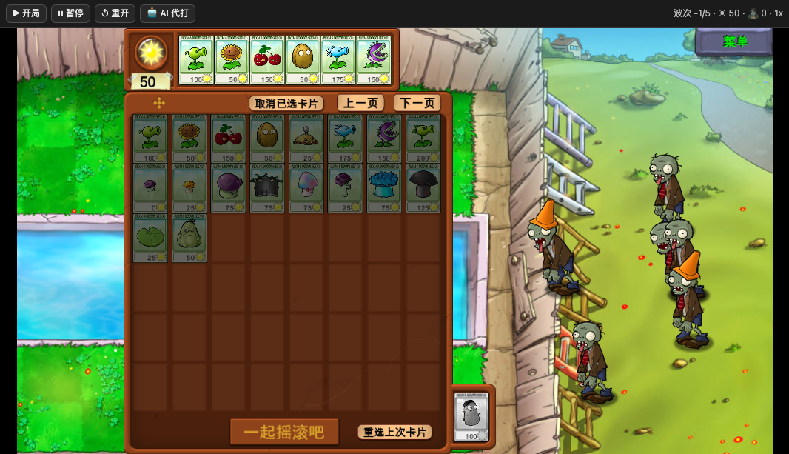
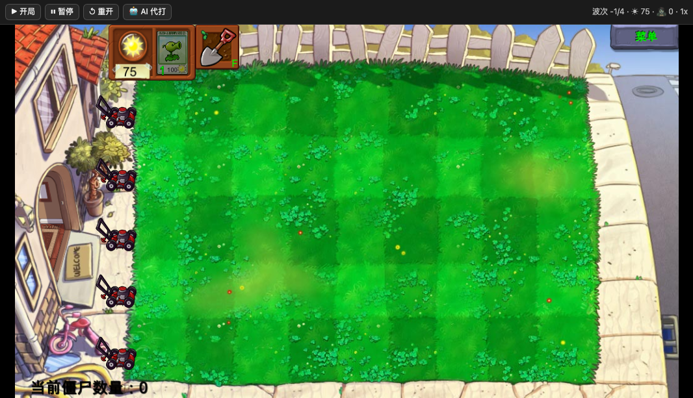
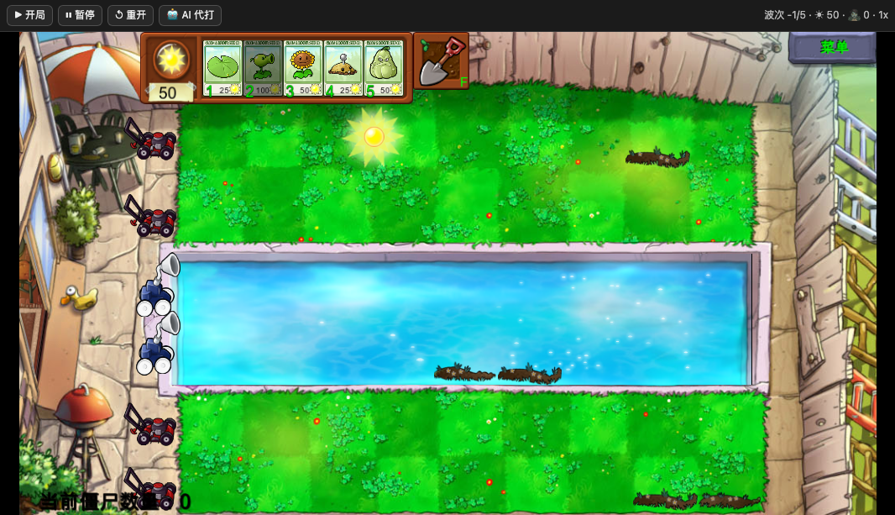
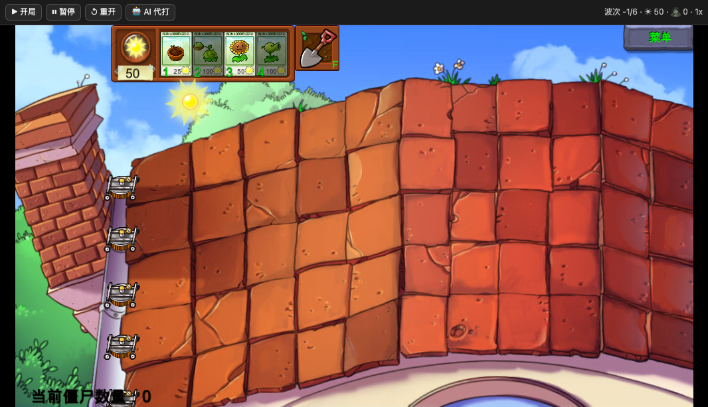

# dsh-pvz · 在 DSH 里玩植物大战僵尸（AI 也能替你打）

一个 [DeepSeek Harness](https://github.com/deepseek-ai) 的插件：把《植物大战僵尸》搬进 DSH 的浮动窗口，并且让 AI 能看着局面替你打、在侧栏里吐槽。

> 目前是**能玩、但还很糙**的状态：战役 50 关的数据已按原版源码录入，UI 和 AI 代打仍在打磨。



---

## 它是什么

- **游戏本体**：[PvZ-Godot](https://github.com/game-a11y/PvZ-Godot)（社区用 Godot 4.5 重写的 PvZ，覆盖冒险/小游戏/解谜/生存，缺僵王和部分小游戏），导出成 **Web 版**跑在 DSH 页面的 iframe 里。
- **插件**：一个 host 插件（Node 侧）+ 一个 client 插件（React，注册 `shell.overlay` 浮窗和左侧栏入口）。
- **AI**：host 里注册 6 个工具（`pvz_launch` / `pvz_board` / `pvz_plant` / `pvz_shovel` / `pvz_control` / `pvz_autoplay` / `pvz_say`），代打时用一个独立的「教练 agent」循环决策，它的对话不进你的聊天，吐槽通过 `pvz_say` 回到面板的「动态」里。

## 现在能做什么

- 左侧栏 🌻 打开浮窗，窗口可拖、可八向缩放、可铺满、可收起（收起后游戏在后台继续跑）。
- 冒险 50 关：关卡波数、僵尸池、初始阳光、卡池全部取自 [PvZ-Portable](https://github.com/wszqkzqk/PvZ-Portable) 的源码表（`gZombieWaves` / `gZombieAllowedLevels` / `GetAwardSeedForLevel`）。
- 原版选卡流程（6 个卡槽、候选卡翻页、点「一起摇滚吧」开打）。
- 关卡地图（面板里 5×10），通关自动进下一关。
- 无尽模式（全植物、10 卡槽）。
- AI 代打开关（面板上 🤖），决策间隔可调。

| 白天前院 | 泳池 | 屋顶 |
|---|---|---|
|  |  |  |

## 已知问题（诚实清单）

- **AI 代打有时不动**：教练 agent 偶发不走到工具调用，正在加日志定位。
- 3 路关卡（1-2 / 1-3）的**草坪美术**还是 5 行的整张背景图，只是逻辑上按 3 行限制（推车和植物只在中间三行）。
- 黑夜关卡的墓碑默认不显示。
- 无尽模式只是「把冒险的最后一关改成无限波」，没有原版无尽的分段难度曲线。
- 5-10 的 BOSS 用巨人 + 投石车 + 蹦极凑数。
- 95 版规则只做了「僵尸血量 ×1.35、移速 ×1.12」的近似，机制项（墓碑、报纸狂暴、摇旗铁桶等）未做。

## 目录结构

```
plugin/            DSH 插件本体（可直接 install_bundle）
  index.js         host：静态托管游戏、/tick 收局面、/ctl 下发指令、6 个工具、教练 agent
  client.js        client：浮窗 + AI 面板（纯 CSS 注入，走 --dsw-alias-* 之外的独立配色）
  campaign.json    50 关的关卡表（波数/僵尸池/卡池/阳光/路数）
  package.json / cordis.patch.yml / locale / icon.svg
bridge/bridge.gd   Godot 侧的桥（autoload）：局面导出 + 指令执行 + Web 版传输
game/              PvZ-Godot 侧需要放进去的数据（campaign/rules/导出预设）
tools/export-web.sh 把 PvZ-Godot 导出成 Web 版
docs/PATCHES.md    对 PvZ-Godot 源码做的所有改动（逐条）
```

## 怎么跑起来

### 1. 准备 PvZ-Godot

```bash
git clone https://github.com/game-a11y/PvZ-Godot
cd PvZ-Godot
# 这个仓库删掉了版权素材，需要从它的 v0.1.1 tag 或作者群里拿 assets/ 放回来
```

把本仓库的 `bridge/bridge.gd` 放到 `scripts/autoload/bridge.gd`，`game/rules/` 放到 `rules/`，`game/adventure.json` 放到 `campaign/adventure.json`，并按 [docs/PATCHES.md](docs/PATCHES.md) 改那几个引擎文件。

### 2. 导出 Web 版

```bash
bash tools/export-web.sh /path/to/PvZ-Godot /path/to/plugin/game
```

（需要 Godot 4.5.1 和 `web_nothreads_release` 导出模板。想省事的话，仓库里已经有现成构建，跳过 1、2 两步直接用 `plugin/game/` 即可。）

### 3. 安装插件

在 DSH 里：

```
plugin_manager action=install_bundle target=<本仓库>/plugin
```

装完刷新页面，左侧栏底部会出现 🌻「植物大战僵尸」。

## 许可与素材

- 本仓库的代码（`plugin/`、`bridge/`、`game/*.json`）：MIT。
- **含 PvZ 素材**：`plugin/game/` 里是 Godot 导出的 Web 构建（原版美术/音频），为了开箱即用才一起放进来。版权属 PopCap / EA，**仅限个人学习与非商业用途**，别拿去卖或大规模传播。
- `.pck` 有 105 MB，超过 GitHub 单文件 100 MB 限制，所以拆成了 `index.pck.part1/part2`；host 插件会按顺序拼成一条流发给浏览器，对游戏无感。
- PvZ-Godot 是第三方项目，有自己的非商用许可；PvZ-Portable 是 LGPL-3.0-or-later。

## 进度

- [x] 桥（局面导出 / 种植 / 铲除 / 暂停 / 调速 / 无尽）
- [x] 50 关战役数据（源码级）
- [x] 选卡界面、关卡地图、自动续关
- [x] 浮窗 + 侧栏入口 + 关闭/收起语义
- [ ] AI 代打稳定性
- [ ] 3 路 / 单路草坪美术
- [ ] 墓碑、白天/黑夜光照
- [ ] 95 版机制项
- [ ] 音效/BGM 缺失补齐
